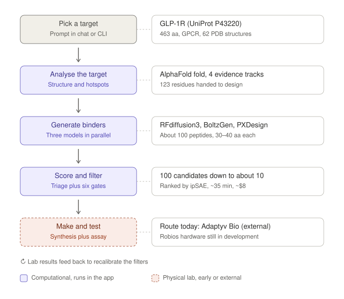
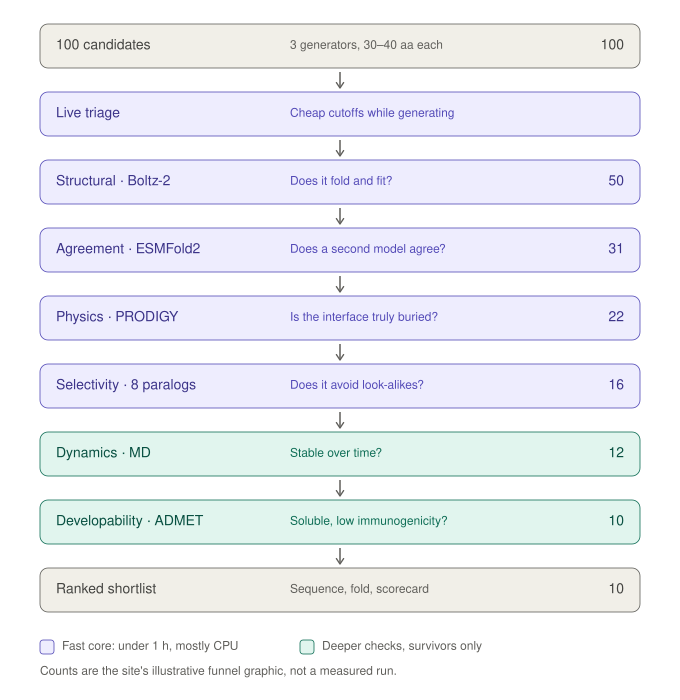

# BIOS (ai.bio.xyz): what it actually does

Researched 2026-09-30, updated 2026-10-01 (added a newcomer primer, a worked GLP-1R walkthrough with two diagrams, and how the generators make sequences). Diagrams are in `assets/`. Everything here comes from public material: the ai.bio.xyz site and blog, Bio Protocol's monthly posts, a conference talk transcript, the arXiv paper, and the papers behind their tools.

Claims carry a source tag: **[site]** landing page, **[blog]** BIOS blog posts, **[monthly]** Bio Protocol monthly updates, **[talk]** DeSci Berlin 2026 talk, **[3rd]** third-party source, **[me]** my own inference or general domain knowledge, not something BIOS says.

---

## TL;DR

1. **It is not repurposing, and it is not classic docking.** BIOS designs *new* short peptide binders (typically 30–40 amino acids) against a protein target. Generative protein-design models invent candidate sequences, and structure-prediction models plus some physics filter them. The design pipeline draws on no approved-drug library and no small-molecule library.
2. **The output is about 10 amino-acid sequences that are *predicted* to bind.** For a "new medicine" that is the starting point. Their own blog concedes that a prediction is not proof.
3. **I found no published experimental hit rate for BIOS's own design campaigns.** A sister project, PeptAI, reported SPR-validated VEGFR2 binders in June 2026, but with no numbers. The GLP-1R showcase is computational.
4. **The hardware (Robios: a synthesis box plus a robotic arm) is a build in progress.** In May they said they were "building" it, and in the talk the robot hand shown was a simulation. Wet-lab work today routes to an outside CRO, Adaptyv Bio.
5. **"BIOS" is two products under one name.** One is a general AI scientist for literature and data analysis (January 2026, with the arXiv paper). The other is a drug-design engine (May–June 2026). The paper covers only the first.
6. **The catch:** the cheap part (compute, about $7–10 per campaign) is real. The expensive, slow, failure-prone part (functional validation, pharmacokinetics, safety, trials) is untouched by the pipeline. Everything else in the material is candidate generation.

---

## Primer for newcomers

Skip this if the vocabulary is familiar. Items tagged [me] are general biology, not claims from BIOS.

| Term | Plain meaning |
|---|---|
| Amino acid / residue | The building blocks of proteins. Once an amino acid is linked into a chain it is called a residue, so "463-residue" means a chain of 463 amino acids. [me] |
| Position numbering | Residues are numbered from one end of the chain. R310 means arginine (R) at position 310. When BIOS flags 123 residues, it means 123 positions that look like part of the binding pocket. [blog] |
| Fold | The chain folds itself into a specific 3D shape, and the shape decides what can fit into it. [me] |
| Structure | A file of 3D coordinates (x, y, z) for every atom. It is not a photograph: scientists measure the protein with X-ray crystallography or cryo-electron microscopy, then fit an atomic model to the data. [me] |
| PDB (Protein Data Bank) | The public archive of these structures. Each entry has a short ID such as 7KI0. [me] |
| UniProt | The reference database of protein sequences and annotations. P43220 is GLP-1R's ID. [blog] |
| GPCR, Class B1 | A receptor that spans the cell membrane (a G-protein-coupled receptor). Class B1 is the subfamily that recognises peptide hormones, and GLP-1R's natural ligand is the GLP-1 hormone. [me] |
| Receptor, ligand, binder | The lock-and-key picture: the receptor is the lock, a ligand is anything that fits in it, and a binder is a designed key. [blog] |
| Predicted vs experimental structure | AlphaFold and Boltz-2 predict a structure from a sequence. PDB entries are measured. BIOS uses both. [blog] |

### Why GLP-1R has 62 structures

The 62 are 62 structures of the receptor (the lock), not of a drug. Think of one lock photographed 62 times, with different keys in it, in different positions, under different setups. Typical reasons for multiple structures [me]:

- **Different ligands bound:** the natural hormone, approved drugs, small-molecule compounds. These co-crystal structures are what BIOS mines for hotspots.
- **Different states:** inactive versus active, with and without its partner protein.
- **Partial pieces:** membrane proteins are hard to work with, so some experiments capture only one domain.
- **Engineered versions:** proteins are often tweaked or stabilised so they hold still long enough to image.
- **Different methods and quality levels.**

I have not inspected the actual 62 PDB entries, so treat this as the typical pattern, not a breakdown of that set.

**Why it matters to BIOS.** The count is a rough measure of how well studied a target is. More structures with ligands bound means more real evidence for where the pocket is. A target with one or no experimental structures leaves BIOS relying on predicted shapes, which is a weaker starting point. [me]

---

## 1. Who is behind it

| Item | Detail |
|---|---|
| Maker | Bio Protocol AI team. Bio Protocol builds crypto-native "decentralized science" (DeSci) infrastructure: a token (BIO), a launchpad, and "BioDAOs" that fund research. [blog] |
| Authors of the design post | Geeve George (robotics/hardware) and Johannes Weniger. Berlin / Bengaluru. [blog][talk] |
| Surfaces | ai.bio.xyz (marketing), chat.bio.xyz (the app), api.ai.bio.xyz (REST + MCP), `bios-cli` (release candidate, repo created 2026-09-29), index.bio.xyz (Open Science Index) [site] |
| Sister project | **PeptAI**: a separate "BioAgent" with its own token and treasury, running an autonomous peptide-discovery pipeline on BIOS infrastructure. Its token sale raised 1.6M+ USDC in May 2026. [monthly] |

**Why the ecosystem matters:** the numbers below are self-reported by a token-funded ecosystem. That is not a reason to dismiss them, but you should weight them accordingly.

### Timeline

| Date | Event |
|---|---|
| 2026-01-18 / 01-28 | arXiv preprint and "Introducing BIOS" (AI Scientist: literature + data analysis) |
| 2026-03 | BIOS API with pay-per-query in crypto (x402). Claims 90% on "BixBench Verified 50" (self-reported). [monthly] |
| 2026-04 | PeptAI's 9-gate peptide pipeline announced (Bio Protocol LinkedIn post) |
| 2026-05 | Live demo: 9-step pipeline, 5,000 candidates, synthesis via Adaptyv. PeptAI token launches (May 14). [monthly] |
| 2026-06-14 (ai.bio.xyz) / 06-18 (bio.xyz) | **"Designing Medicine, One Binder at a Time"**: the binder pipeline plus the robotic-lab announcement. [blog] |
| 2026-06 | Image segmentation and object tracking shipped. PeptAI reports first SPR results on VEGFR2. [monthly] |
| 2026-08-11 | PeptAI announces four KISS1R/OX2R candidates going to the lab for the first time. As of 2026-09-14 no result had been published. [3rd: Caper wiki] |

---

## 2. Docking, design, or repurposing?

| | Docking / virtual screening | Drug repurposing | **BIOS** |
|---|---|---|---|
| Starting point | Library of existing molecules + one protein pocket | Approved drugs + a new disease | A target protein only |
| What is searched | Known chemical space | Known drugs | *Generated* sequence space (molecules that never existed) |
| Output | Ranked list of existing compounds | Drug + new indication | About 10 peptide sequences (30–40 aa) |
| Drug class | Mostly small molecules | Anything approved | Peptide / mini-protein binders |
| Safety data on the output | None | Extensive | None |
| Path to a medicine | Full development | Shorter (safety and PK already known) | Full development, as a new peptide drug |

**How it differs from docking:**
- Docking places a *known* ligand into a pocket and scores the pose.
- BIOS starts one step earlier: a generator *invents* the ligand.
- The scoring models (Boltz-2, ESMFold2) predict the whole complex jointly, "co-folding." They do not search poses against a hand-built scoring function.
- The talk says "docks" loosely when describing MD checks. Do not read that as classic docking.

**The blog's mental model** is locks and keys. A receptor is a lock. A binder is a key. It puts finding the keyhole at roughly 10% of the work and making the key at the other 90%. [blog]

---

## 3. Component by component

BIOS's landing page lists nine stages: target definition → data retrieval → annotation → binder generation → scoring and filtering → validation → candidate selection → wet-lab synthesis → feedback loop. [site]

### 3.0 One run end to end (GLP-1R example)

In one line: a target protein goes in, and a ranked shortlist of candidate binders comes out.

| Stage | What happens | GLP-1R example | Source |
|---|---|---|---|
| Pick a target | Name a receptor in a prompt. BIOS fetches the sequence and structure itself. | UniProt P43220, 463 aa, 62 PDB structures | [blog] |
| Analyse the target | AlphaFold fold plus four evidence tracks for hotspots (§3.1). The blog's walkthrough has a "Generate Binders" button between analysis and design, so there is a human click at this point. | 123 residues handed to design | [blog] |
| Generate binders | Three models run in parallel (§3.2). | About 100 peptides, 30–40 aa | [blog] |
| Score and filter | Live triage, then six gates (§3.3). | 100 down to about 10, ~35 min, ~$8 | [site] |
| Make and test | Synthesis and assay. Today this routes to an outside service; in-house hardware is in development (§3.5). | Adaptyv Bio (external) | [monthly] |
| Feedback | Lab results are meant to recalibrate the filters (§3.6). | Not shown working | [blog] |

**What comes out.** About 10 candidates, each with its own scorecard: the amino-acid sequence, the predicted fold bound to the target, the confidence metrics, and a pass/fail verdict. [blog] The blog shows these scorecards as images and I saw no published example sequence, so I have not reproduced one here.

**What it is not.** A confirmed drug. "Binder" only means the design is predicted to stick. Whether it switches the receptor on, blocks it, or does nothing needs a separate cell-based test, which BIOS's material does not yet show working (§3.5).

**Where you use it.** The design workflow is in the chat app (chat.bio.xyz). The landing page shows a CLI command for it (`bios design --target GLP1R --n 100`), but I could not confirm that the current CLI release supports design. The public API documents literature, data analysis and deep research only. [site]

### 3.1 Target analysis (stages 1–3)

What it does, with GLP-1R (UniProt P43220, 463 residues, 62 PDB structures) as the worked example [blog]:

1. **Structure.** Pulls the UniProt record and predicts the fold with AlphaFold. It shows two confidence signals next to the structure: pLDDT (per-residue confidence) and PAE (predicted error between residue pairs).
2. **Hotspots ("keyholes").** Fuses four evidence tracks and scores each residue by how many agree:
   - P2Rank: ML pocket prediction from structure.
   - Co-crystal data: residues from solved complexes (e.g. PDB 7KI0).
   - Literature/mutagenesis: alanine scans and binding assays.
   - Known class-level pocket residues for the receptor family.
3. On the GLP-1R run, 46 of 81 scored residues cleared the high-confidence bar (score ≥ 2.0). With P2Rank's pocket added, 123 residues were handed to design.

**Website tile:** "ANALYZE / Target Analysis" is this step. [site]

### 3.2 Generators (stage 4)

Three models run in parallel on every campaign, chosen because their failure modes should not correlate. [blog]

| Engine | What it is (per its own papers/docs) |
|---|---|
| **RFdiffusion3 + ProteinMPNN** | Diffusion model that shapes a backbone to the pocket. ProteinMPNN then assigns a sequence that should fold into it. |
| **BoltzGen** | All-atom generative model that unifies design and structure prediction. Supports peptide-specific protocols. MIT licensed. |
| **PXDesign-d** | ByteDance's diffusion-transformer backbone generator. The authors report 17–82% nanomolar hit rates on six of seven targets for *protein* binders (60–160 aa). |

- A full campaign yields about 100 candidates across the three engines, typically short peptides of 30–40 residues. [blog]
- The talk also lists BindCraft and Genie 3 as available. [talk]
- The landing page describes PXDesign as "sequence–structure co-design." The PXDesign paper describes backbone diffusion followed by ProteinMPNN. Small wording mismatch. [site vs 3rd]

#### How a generator makes a sequence

These models generate new sequences. They do not search a library of existing ligands. [blog][3rd]

Where known ligands do enter:
- **Finding the target spot.** Hotspots use solved structures and mutation studies of known ligands in the receptor (§3.1). That tells BIOS where to aim, not what to build.
- **Training.** The generators learned from large numbers of real protein structures, including many protein–protein complexes, so they have seen what good interfaces look like. [3rd]
- **No template peptide.** As described, the pipeline does not start from a known peptide such as the natural GLP-1 hormone and modify it. PeptAI's MOTS-c work is a different mode that does start from a natural peptide (§3.7).

How the sequence appears (from the model papers and docs; BIOS does not publish its own settings) [3rd]:
1. **Start from noise.** Much like an image generator starting from static, the model begins with a cloud of atoms near the target's pocket and cleans it up step by step ("diffusion"). The target structure and chosen hotspots steer it into a shape that packs against the pocket.
2. **Get a sequence from the shape.** Either in a second step (ProteinMPNN runs AlphaFold's job in reverse: shape in, sequence out) or together with the shape in a single model (BoltzGen).
3. **Repeat with new random noise.** Each run gives different candidates, which is why BIOS generates about 100 and then filters.

| Engine | Shape | Sequence |
|---|---|---|
| RFdiffusion3 + ProteinMPNN | Diffusion builds the backbone | ProteinMPNN assigns it afterwards (as BIOS describes it) |
| BoltzGen | One all-atom model | Designed together with the shape |
| PXDesign-d | Diffusion transformer builds backbone coordinates | ProteinMPNN assigns it afterwards (per the PXDesign page) |

Caveats:
- **Novel sequence, not novel biology.** The models learned from natural proteins, so a sequence can be new while the way it binds mimics patterns seen in nature. [me]
- **RFdiffusion3 discrepancy.** BIOS's blog describes shape first, then ProteinMPNN. A third-party API provider documents RFdiffusion3 as diffusing structure and sequence together. I have not resolved which is how BIOS runs it. [blog vs 3rd]
- **Unpublished settings.** How hotspots are passed in, how many samples each engine produces, and peptide length limits are not stated in BIOS's material.

### 3.3 Scoring and filtering (stage 5): the six gates

First a cheap in-loop triage during generation: pLDDT ≥ 70, ipTM ≥ 50%, iPAE < 10. [blog] Then six gates:

| # | Gate | Tool | What it asks | Stated threshold | Failure it catches |
|---|---|---|---|---|---|
| 1 | Structural | Boltz-2 co-fold | Does it fold and form a plausible interface? Returns ipTM, ipSAE, pLDDT, interface RMSD, predicted binding free energy | ranks on ipSAE | designs that won't fold |
| 2 | Agreement | ESMFold2 (Fast), 3 seeds | Does an independent predictor agree on the pose? | flags disagreement | poses Boltz-2 invents (hallucinations) |
| 3 | Physics | PRODIGY, FreeSASA | Buried surface area, interface energy, affinity estimate | not stated | weak interfaces |
| 4 | Selectivity | Boltz-2 × 8 paralogs; mmseqs2 + Foldseek over a 398-GPCR database | Does it bind the target and *not* its closest relatives? | Δ-iPTM ≥ 0.2 (blog); Δ-ipSAE margin (site) | binders that bind everything |
| 5 | Dynamics | Molecular dynamics | Is it stable over time, membrane-embedded? | not stated | designs that fall apart |
| 6 | Developability | "ADMET" | Solubility, aggregation, immunogenicity | not stated; no tool named | undruggable candidates |

- Gates 1–4 are the fast core (under 1 hour, under $7, mostly CPU). MD and ADMET run only on survivors. [site]
- The survivor counts in the diagram come from the landing page's funnel graphic (100 → 50 → 31 → 22 → 16 → 12 → 10). It is not stated to be from a real run. [site]
- On selectivity, the blog says cross-reactivity is the dominant failure mode for GPCR peptide drugs.

**A point about independence.** The blog's principle is that the models judging a design are never the models that made it. Two things complicate that [me]:
- BoltzGen's own pipeline already refolds designs with Boltz-2 (per the BoltzGen paper). So the Boltz-2 structural gate is not independent for the BoltzGen lane. The ESMFold2 gate is the truly independent check.
- "Independent" here means different architectures. Both predictors were trained largely on the same PDB data, so shared blind spots are plausible.

### 3.4 The ranking metric: ipSAE

- The metric they rank on is **ipSAE**. They cite the Overath et al. meta-analysis (3,766 experimentally tested binders, 15 targets). It found ipSAE gave a **1.4× higher average precision than ipAE**. [blog + 3rd]
- The site says the gate design follows "the Overath architecture": one deep-learning confidence metric, one orthogonal physicochemical descriptor, and cross-model agreement as the false-positive filter. [site]
- Read that 1.4× as a *relative* improvement in ranking. In the same dataset only 436 of 3,766 designs (11.6%) were confirmed binders. [3rd]
- The meta-analysis is about *protein* binders against targets of 60–621 residues. Whether its thresholds transfer to 30–40 residue peptides against GPCRs is not established in what I read. [me]

### 3.5 Hardware: "Robios" (stage 8)

| Piece | Claim | Source |
|---|---|---|
| Synthesis box | A printer-sized box that mixes peptide vials. 10 candidates = 10 vials. First run makes test peptides for the arm; later it re-synthesises winning peptides. | [site] |
| Robotic arm | 5-DOF arm + 21-DOF dexterous hand. Tests each vial on cell cultures, watches for receptor activation. | [site] |
| Blog version | Solid-phase synthesis → HPLC purification → mass-spec QC, "unattended." A robotic SPR/BLI station measures binding against the target *and* the paralog counter-targets. | [blog] |
| Talk version | "Robios," a lab-in-a-box. The hand is trained by reinforcement learning in simulation for pipettes and well plates, and the speaker said the robot footage on screen was a simulation. Long-term vision: a peptide synthesizer in every home. | [talk] |
| May status | "BIOS is building a robotic arm" for pipetting, plate transfers and binding assays. Today wet-lab runs go to Adaptyv Bio, paid via x402. | [monthly] |

- **Inconsistency worth noticing.** The site says the arm assays *receptor activation on live cells*, meaning function. The blog says *SPR/BLI*, meaning binding on purified protein. These measure different things. A binder can bind tightly and do nothing, or block instead of activate.
- Running SPR/BLI on a purified GPCR is also technically hard. [me]
- I found no public report of a candidate that was synthesized and assayed end-to-end by BIOS's own hardware.

### 3.6 Feedback loop (stage 9)

- Every wet-lab result returns to the model. The blog says ipSAE thresholds get recalibrated and composition filters tightened per target class. [blog]
- The talk describes regenerating designs "more like" the successful ones. [talk]
- The mechanism is described only at that level. Nothing says whether models are fine-tuned or just thresholds adjusted. Nothing shows the loop closed more than once.

### 3.7 Wet-lab routes that exist today

- **Adaptyv Bio** (external protein-testing service), paid machine-to-machine via x402 crypto payments. This is the current route. [monthly]
- **PeptAI** runs its own 9-gate pipeline (G1–G8 computational, G9 wet-lab handoff to Adaptyv). It also does analogue optimisation. Example: 306 chemically modified versions of the peptide MOTS-c in 150 minutes, with 3 shortlisted. That post says outright that no peptides had been made or tested. The planned wet-lab work was estimated at **$35,000–60,000 over 10–14 weeks for 11 peptides and 3 assays.** [monthly]

That last figure is the honest cost picture. Compute is about $10 and the lab is tens of thousands of dollars.

### 3.8 The research agent (the "AI Scientist" half)

This is the January 2026 product and the subject of the arXiv paper. [blog]

- **Loop:** Plan → Execute → Refine ("Deep Research"), with a persistent **world state**: objective, current hypothesis, discoveries, insights, datasets.
- **Four agents:**
  - Planning: decomposes questions, prioritises tasks.
  - Literature: fans out over 7 sources (ArXiv, PubMed, CrossRef, Semantic Scholar, Google Scholar, ClinicalTrials.gov, UniProt), then re-ranks by embedding similarity plus LLM scoring. Fast mode is metadata only. Deep mode reads full-text PDFs with citations.
  - Data Analysis: writes and runs Python, self-corrects on errors with bounded retries, and keeps a knowledge base of rules and facts it discovered.
  - Novelty Detection: checks whether a hypothesis has been investigated before.
- **Modes** (API): `steering` (1 iteration, about 20 min), `semi-autonomous` (up to 5, about 1 h), `fully-autonomous` (up to 20, about 8 h). [site: /developers]
- **Benchmark:** BixBench (bioinformatics analysis): 48.78% open-answer, 55.12% multiple-choice with refusal, 64.39% multiple-choice without refusal. Compared with K-Dense 34.4%, Kepler 33.4%, GPT-5 22.9% on open-answer. [blog]
  - Read that as *getting about half of open-answer analysis questions right*. It is good relative to peers, not reliable in absolute terms.
  - The separate "90% on BixBench Verified 50" claim is self-reported on a 50-question subset. I did not check the subset or the harness. [monthly]
- **Openness:** the underlying BioAgents framework is public, but its GitHub repo is now archived. The Literature and Analysis agents are not open source. A longevity agent, Aubrai, is planned as a subagent. [blog]

### 3.9 The "More useful tools" tiles

The landing page shows four tiles. [site]

| Tile | What it is | Detail |
|---|---|---|
| **Retrieve → Bioinformatic Databases** | Query public databases inline | The page does not list which. The evidence points to UniProt, AlphaFold DB, PDB, ChEMBL, and literature sources (PubMed, ClinicalTrials.gov, etc.). Also the Open Science Index. |
| **Segment → Segment Anything** | Image segmentation and counting | Upload an image, click an example object, describe what to count in plain language. The GPU runs in the cloud and the result returns in chat. [monthly] |
| **Track → Track Video** | Object tracking in video | Upload an MP4, click an object in the first frame, and BIOS follows it. Examples in the talk: mouse behaviour, an immune cell chasing bacteria. [monthly][talk] |
| **Analyze → Target Analysis** | The target-annotation step from §3.1 | Structure confidence + hotspot fusion. |

- The name suggests Meta's Segment Anything family, and the "click an example object" interaction matches SAM-style prompting. The exact model version is not stated. [me]
- **These are general lab-science conveniences, unrelated to binder design.** They exist so BIOS can serve as an all-purpose workbench, including for wet-lab microscopy and behaviour data.
- **Open Science Index** (index.bio.xyz): a directory of about 6,720 open-source tools, models and datasets, aggregating catalogues like bio.tools and Hugging Face. [monthly, 2026-09-04]

### 3.10 The rest of the site

- **API / MCP / CLI.** REST at `api.ai.bio.xyz` plus an MCP server with 15 tools, using bearer-token keys (`bio_sk_…`). It covers deep research, literature, data analysis and file upload. **The API docs expose no binder-design endpoint.** Design appears to be app-only for now. The CLI (`bios design --target GLP1R --n 100`) is shown on the landing page, but the public `bios-cli` repo is a release-candidate installer whose source is private. [site]
- **"Atlas"** (ai.bio.xyz/agent-harness-atlas) is a source-level comparison of eight *coding-agent* harnesses. It has nothing to do with medicine. It reads as content marketing.

---

## 4. The numbers, side by side

Compute costs vary because the campaign size varies. None of them include synthesis or assays.

| Stated figure | Where | Note |
|---|---|---|
| 100 designs → 10, ~35 min, ~$8 | [site] | Full run |
| Under 1 h, under $7 | [blog][site] | "Fast core" gates 1–4 |
| $0.73 | [blog] | KISS1R, a smaller and quicker run. Cost only, no results shown. |
| 5,000 candidates → 10–15 | [monthly] | May demo |
| 1,000 candidates in 1–2 h for ~$30 | [talk] | |
| ~120 vetted designs for ~$10 in 1 h | [talk] | |
| "~$10 a verified candidate" | [monthly] | "Verified" is not defined, and it is not clear it means wet-lab verified |
| $7 per patient-specific campaign | [blog] | The vision section. Compute only. |
| $35–60k, 10–14 weeks for 11 peptides | [monthly] | PeptAI's estimated lab cost |

---

## 5. The catch, ordered by importance

1. **It generates candidates; it does not produce medicines.** A binder that sticks to a receptor is not an agonist, an antagonist, or a drug. Function, stability in the body, immunogenicity, delivery, toxicity, an IND, and trials all remain. Bio's own figure is a ~96% trial failure rate. [monthly]
2. **Computational confidence is a weak proxy for experimental success.**
   - Only 11.6% of the Overath dataset's designs were confirmed binders, and ipSAE's edge is relative.
   - A-Alpha Bio tested Boltz-2 confidence scores against more than 7 million measured affinities. They found the scores work as *negative filters* but produce high false-positive rates and cannot reliably rank affinity. [3rd]
   - The same piece cites an Adaptyv competition where ipTM reached AUROC 0.64 on EGFR. [3rd]
   - A September 2026 preprint on peptide scoring reports that Boltz-2 representations were the most informative for binding affinity but were confounded by peptide molecular weight. [3rd]
3. **No public wet-lab validation of BIOS's own designs that I could find.** The GLP-1R showcase and the March "three GLP-1R agonists designed from scratch" are computational. PeptAI's VEGFR2 SPR result is real but has no hit rate or affinity figures, and PeptAI is a separate entity. The Caper wiki (third-party) listed the newer PeptAI candidates as predictions only, as of mid-September.
4. **The hardware is unproven and early.** See §3.5. The current wet-lab route is external.
5. **The showcase target is the easiest case.** The blog picks GLP-1R precisely because it is among the best-studied targets. It has 62 PDB structures, known co-crystal complexes, and approved peptide drugs. A win there says little about novel or poorly characterised targets. [me]
6. **Selectivity is checked against 8 close paralogs, not the proteome.** That is sensible for GPCRs, but it is not a safety screen.
7. **Aspirational framing in the hero copy.** The design-on-screen-to-vial-in-hand story, per-patient medicines, and the $7-per-patient figure describe a vision. The regulatory route for a patient-specific peptide is not addressed anywhere in the material.
8. **Numbers and descriptions drift between pages.** See §3.5 (SPR vs receptor activation), §3.3 (Δ-iPTM vs Δ-ipSAE), and the cost table in §4.

### What is credible

- The blog is candid that a prediction is not proof and that a predicted fold is a hypothesis, not a fact. Its argument for closing the loop with real data is sound.
- It builds on open, published models (RFdiffusion3, BoltzGen, PXDesign, Boltz-2) rather than a black box.
- Choosing ipSAE and an orthogonal descriptor follows a real published meta-analysis.
- Ensembling three generators with cross-model checks is a defensible way to cut false positives.
- Compute for exploring candidates really is cheap now. This is the field's trend, not just BIOS's claim.

---

## 6. The paper: is it worth reading?

**arXiv 2601.12542**, "Rethinking the AI Scientist: Interactive Multi-Agent Workflows for Scientific Discovery" (v2, 27 Jan 2026, cs.AI).

- **Covers:** the Deep Research architecture: planner, literature, data-analysis and novelty agents, world state, the two autonomy modes, and BixBench results (48.8% open-response, 64.4% multiple-choice, 14–26 points over baselines). It also discusses limits: open-access literature gaps and the difficulty of automated novelty assessment.
- **Does not cover:** the binder-design pipeline, the six gates, or the hardware. I found no paper for those. The June blog is the only documentation. I read the abstract, not the full PDF.

**Recommendation:** read it only if you care about the research-agent side. For the design side, this order pays off more:

1. **Overath et al.**, bioRxiv 10.1101/2025.08.14.670059: why ipSAE, and what its base rates look like.
2. **BoltzGen** (github.com/HannesStark/boltzgen): what the generator and its built-in filter do.
3. **PXDesign** (bioRxiv 2025.08.15.670450): hit rates from a real wet-lab campaign on protein binders.
4. **A-Alpha Bio, "Overconfident"** (Substack, Feb 2026): the counter-argument on confidence scores.
5. **BoltzProt-1 technical report** (boltz.bio): even with an improved ranker, the reported confirmed-binder rate on low-homology nanobody targets was 8.0% (up from 3.3%). Realistic base rates are low.

---

## 7. Not verified, and questions worth asking them

**What I did not check:**
- The chat.bio.xyz app itself. It needs an account.
- The full text of the arXiv paper and of Overath et al. beyond the early results.
- Any video or photo evidence of the hardware beyond the talk.
- Their X posts.
- Which peptide binders, if any, were in the Overath data.
- The actual 62 GLP-1R PDB entries. The reasons for multiple structures in the primer are the typical pattern for a receptor like this.
- BIOS's exact generator settings and whether the current CLI release supports binder design.

**Questions to put to them:**
1. What is the experimental hit rate of BIOS-designed binders, per target, at what affinity threshold, and how many designs were tested?
2. Have any designs been assayed for *function* (agonism or antagonism), not just binding?
3. Is there an end-to-end run on Robios hardware, from synthesis to assay, with data?
4. How were gate thresholds calibrated for 30–40 residue peptides when the reference dataset is protein binders?
5. What tool sits behind the "ADMET" gate, and has it been validated on peptides?
6. When does the design engine reach the API?

---

## 8. A note for the repurposing work

BIOS and repurposing sit at opposite ends of the risk curve. Repurposing starts from molecules with human safety data and asks where they might work. BIOS starts from nothing and asks what could be built. They are complementary rather than competing.

The one overlap is data. BIOS's literature agent (PubMed, ClinicalTrials.gov, and more) is available by API, and the Open Science Index catalogues open datasets. Both are possible inputs.

---

## Sources

**BIOS / Bio Protocol**
- ai.bio.xyz landing page, including filter descriptions read from the live page
- ai.bio.xyz/blog/introducing-bios (2026-01-28)
- ai.bio.xyz/blog/designing-medicine-one-binder-at-a-time (2026-06-14)
- ai.bio.xyz/developers (API docs) and ai.bio.xyz/agent-harness-atlas
- bio.xyz monthly posts: March, May and June 2026 editions; plus the blog index
- bio.xyz/blog-posts/bios-the-ai-scientist-accelerating-the-path-from-research-to-product
- DeSci Berlin 2026 talk, "Building the Autonomous Wet Lab of the Future: Robios & BIOS" (YouTube, auto-generated transcript, so treat wording as approximate)
- github.com/bio-xyz/BioAgents (archived) and github.com/bio-xyz/bios-cli
- index.bio.xyz

**Papers and third-party**
- arXiv 2601.12542, the BIOS AI Scientist paper
- Overath et al., bioRxiv 10.1101/2025.08.14.670059 (ipSAE meta-analysis)
- BoltzGen paper and repo (Stark et al.)
- PXDesign, bioRxiv 2025.08.15.670450, and github.com/bytedance/PXDesign
- A-Alpha Bio, "Overconfident: What Structure Prediction Confidence Scores Tell Us About Binding" (aalphabio.substack.com, 2026-02-24)
- BoltzProt-1 technical report (boltz.bio)
- Caper wiki entry on PeptAI (caper.network/wiki/desci/ecosystem/peptai)
- JapanFold API docs for RFdiffusion3, BoltzGen and PXDesign (docs.japanfold.aiand.com/designs/), used for the RFdiffusion3 discrepancy note
- PXDesign project page (protenix.github.io/pxdesign)
- Peptide-scoring preprint on descriptors vs deep-learning embeddings (Trolliet et al., 2026)
