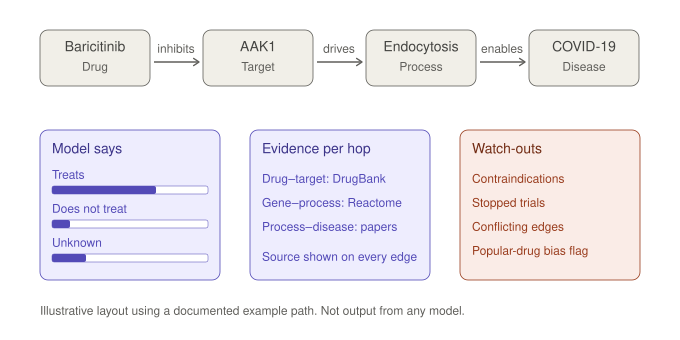

# Knowledge-graph and GNN models for drug–disease prediction: survey for Heisenberg v1

Researched 2026-10-07. Based on search excerpts, not full papers, so check anything you plan to quote or depend on. Source tags: **[verified]** I read it in a source this session, **[me]** my inference.

Companion to [problem-statement.md](problem-statement.md).

---

## 1. Bottom line

1. **There is no single "best" model.** Every claim of beating TxGNN comes from the authors' own benchmark. Margins run from +3.4% AUPRC (CellAwareGNN) to claims of +10–15% (HAMGNN). I found no independent replication of any of them.
2. **Two components are open and usable today:** Every Cure's MATRIX scores (39.5M precomputed pairs, CC-BY) and TxGNN (MIT code, an example pretrained model, a built-in explainer).
3. **Only some models can explain themselves.** TxGNN, KGML-xDTD, XG4Repo and DBR-X give edge-importance or path explanations. MATRIX gives scores, with a three-way probability (treat / not treat / unknown) but no per-pair explanation in the public data.
4. **An explanation says why a model answered, not whether the answer is true.** It has to be tested for faithfulness and stability, and paired with counter-evidence the models do not contain.
5. **Evaluation is the weak link.** Leakage, popularity shortcuts and cold-start collapse inflate reported numbers. Build a benchmark harness before choosing a model.
6. **GNNs help most for diseases with no known drugs.** Under TxGNN's standard (non-zero-shot) evaluation the best baseline was close (AUPRC 0.873 against TxGNN's 0.913), and the authors note such models mostly retrieve drugs similar to a disease's existing treatments. The large gains appear in the zero-shot setting. [verified]

---

## 2. The knowledge graphs underneath

| Graph | Size | Sources | Notes |
|---|---|---|---|
| PrimeKG | 129,375 nodes, ~4.05M edges | 20 | TxGNN's graph. Harvard Dataverse. Code MIT. Dataverse lists the dataset as CC0 1.0 (release v2.1, May 2022); underlying sources may carry their own terms [me]. [verified] |
| RTX-KG2 | 6.76M nodes, 46.4M edges | 64 | Biolink-compliant. Code MIT, artifacts CC-BY, but content licences (UMLS and others) restrict redistribution. Only graph to meet every criterion in a 2025 KG quality review. [verified] |
| ROBOKOP | 4.66M nodes, 26.3M edges | 45 | Biolink-compliant. [verified] |
| Monarch KG | 1.13M nodes, 12.2M edges | 87 | [verified] |
| DRKG / Hetionet / PharmKG | 97k / 47k / 188k nodes | 6 / 29 / 7 | Older, custom data models. [verified] |
| SPOKE, EmBiology | not stated | not stated | Largely behind paywalls, so low accessibility. [verified] |
| **EC-KG** (Every Cure) | 7.35M nodes, 81.1M edges | 95 | Unifies RTX-KG2, ROBOKOP and PrimeKG with provenance. Nodes and edges on Hugging Face (CC-BY; upstream licences apply). [verified] |
| DrugMechDB | 4,583 indications, 5,666 paths | curated | Human-curated mechanism paths. The ground truth for explanation quality. [verified] |
| Open Targets | time-stamped releases | many | Makes temporal benchmarks possible (KG-Bench). [verified] |

Another paper counts PrimeKG at about 8.1M edges, probably counting both directions. [me]

---

## 3. The models

### 3.1 Core: score plus explanation from a knowledge graph

| Model | Strengths | Weaknesses | Explains? | Availability and evidence |
|---|---|---|---|---|
| **TxGNN** (Nature Medicine 2024) | Zero-shot for diseases with no drugs. Predicts indications and contraindications for 17,080 diseases. +49.2% and +35.1% accuracy over 8 baselines. Predictions matched off-label use in health records. | Depends on PrimeKG quality. Lacks host–pathogen detail. A recently approved antiviral (maribavir) ranked at the 66th percentile in the preprint. Human study was n=12. Competing preprints report cold-start and popularity-bias failures. | Yes: edge importance (GraphMask) shown as multi-hop paths. Faithfulness loss 0.98% AUPRC (preprint). | MIT code, example pretrained weights, explorer at txgnn.org. Peer-reviewed. |
| **MATRIX** (Every Cure) | Precomputed for ~1,800 drugs × ~22,000 diseases. Three-class output. Refreshed about quarterly. Used in real programs with expert review. | Scores indicate biological plausibility, not repurposing potential (their words). Drug list is a curated subset of approved drugs. No per-pair explanation in the public data. Shares PrimeKG with TxGNN, so not independent. The file does carry its training labels (63,454 label-only rows, unscored) and curated trial-outcome flags, but the flags cover only about 107 pairs. | Scores only | CC-BY data; upstream licences apply. Open pipeline. Peer-reviewed concept paper (Lancet Haematology 2025); EC-KG paper is a 2026 preprint. |
| **KGML-xDTD** | Treatment probability plus KG path explanations from reinforcement learning, checked against DrugMechDB. Precomputed predictions and paths are served in ARAX. | Paths capped at 3 hops. Training needs a DrugBank academic licence. Rebuilding the database takes about 3 weeks including GPU time. | Yes: paths | MIT code. Peer-reviewed (GigaScience 2023). |
| **XG4Repo** | Path and metapath rules with importance scores. Works on any biomedical KG. | Older (2024). Small case studies. | Yes: rules and paths | Peer-reviewed (Scientific Reports 2024). Code not checked. |
| **DBR-X** | Case-based GNN. Tests faithfulness (deletion/insertion), stability under perturbation, and agreement with curated mechanisms. Beats GNNExplainer and PGExplainer baselines. | New. Code availability not checked. | Yes: paths | Peer-reviewed (Bioinformatics 2026). |
| **CellAwareGNN** | Adds cell-type-specific single-cell context to PrimeKG. Evaluated across all 1,169 test diseases, not a random subset. AUPRC 0.826 vs TxGNN 0.799. | Gain is modest (+3.4%), largest in autoimmune disease. New KG to maintain. Single-cell data from one cohort. | Partly | Preprint and ACM paper. Code not checked. |

### 3.2 LLM plus knowledge-graph hybrids

| Model | Strengths | Weaknesses | Explains? | Availability and evidence |
|---|---|---|---|---|
| **RepurposeAgent / DrugKLM** (NCBI, 2026) | Combines KG, literature and LINCS perturbation data. Disease-specific ranking with mechanistic rationale. Beats KG-only and LLM-only baselines including TxGNN. Scores align with survival signatures across 12 TCGA cancers. | Validation is cancer-focused. LLM cost and drift. | Yes: LLM rationale grounded in evidence | Public code. Preprint. |
| **DrugReason** (Sep 2026) | KG reasoning plus LLM mechanism inference, routed among experts. | Very new. | Routing-based | arXiv preprint |
| **LLaDR** (2025) | LLM concept descriptions refine KG embeddings. Robust to noise. | LLM description errors propagate. Black box. | No | arXiv. Public code. |
| **Graph-of-Thoughts + PrimeKG** (2025) | LLM reasons over retrieved KG paths. Similar accuracy to unconstrained agents with 55% fewer tokens. | Works on a given drug–disease pair, so it checks candidates rather than discovering them. [me] | Yes: structured hypothesis | OpenReview |
| **ESCARGOT on AlzKB** | Disease-specific KG plus LLM. Better overlap with known Alzheimer's drugs than TxGNN and RotatE in their test. | One disease. Metric is overlap with previously reported drugs, which is not validation. | Yes | Published article |
| **Clinical-outcome KG-RAG LLM** (Jan 2026) | Uses Phase III outcomes as training reward. Targets popularity bias and cold start. | Own benchmark. Dramatic claims (GNNs at 0.2–0.4 top-10 precision, itself 0.90). Unreplicated. | LLM-level | bioRxiv preprint |

### 3.3 Agents and tool-using LLMs

| Model | Strengths | Weaknesses | Explains? | Availability and evidence |
|---|---|---|---|---|
| **TxAgent** (Zitnik, 2025) | 211 tools over openFDA, Open Targets and Monarch. Reasoning trace with every tool call. Handles contraindications and patient context. | Reasons about drugs and treatments; it does not rank all drug–disease pairs. Authors' own benchmarks. | Yes: step-by-step trace | Weights on Hugging Face (Llama 3.1 licence). `pip install tooluniverse`. |
| **TxGemma / Agentic-Tx** (Google, 2025) | Open 2B/9B/27B models. Chat variants explain predictions. | Predicts properties (e.g. toxicity), not indications. Authors say wet-lab validation is future work. | Yes: conversational | Open models |
| **AI co-scientist** (Google, Nature May 2026) | Multi-agent hypothesis ranking. Proposed KIRA6 for leukaemia, selective for leukaemia cells in assays. | Cell-assay level only. Experts filtered candidates. Not clearly open. | Yes | Nature. Access not checked. |
| **Robin** (FutureHouse, Nature May 2026) | Closes the hypothesis-to-experiment loop. Ripasudil for dry macular degeneration (1.89× phagocytosis in cells). | One case study. Humans ran the experiments. In vitro. | Yes | Nature. Access not checked. |

### 3.4 Treat with caution

**HAMGNN** (Frontiers in Bioinformatics, 2026) reports AUC 0.98 and +10–15% over TxGNN. The paper attributes TxGNN to the wrong authors, and the numbers are far above anything else in this survey. I would not rely on it. [me]

### 3.5 Simple baselines to include

- **Popularity:** rank by how many diseases a drug already treats.
- **Matrix completion:** OMC and BNNR led a 2025 benchmark of 10 network methods. That benchmark also found that cross-validation choices swing AUPR, and that earlier studies overestimated performance by omitting negatives. [verified]
- **Network proximity**, as used in the Alzheimer's and sildenafil work.
- **Similar-disease borrowing:** rank drugs approved for the most similar diseases. This is the idea behind TxGNN's disease pooling, so it shows how much the GNN adds beyond it. [me]

### 3.6 For v2: cold-start drug–target models

**HierHGT-DTI** (BMC Bioinformatics, Sep 2026; public code; +8.8 AUROC points on cold-protein DrugBank) and **ColdstartMHDTI** (Frontiers in Chemistry, Jul 2026; public code). Both target proteins with no known ligands. [verified]

---

## 4. Can they reason, and say "this works" or "this doesn't"?

### 4.1 Kinds of output

| Output | Models |
|---|---|
| Score only | MATRIX, TxGNN predictor |
| Negative class | TxGNN contraindications; MATRIX not-treat and unknown probabilities |
| Edge importance | TxGNN (GraphMask) |
| Path explanation | KGML-xDTD, XG4Repo, DBR-X, TxGNN Explorer |
| LLM rationale | RepurposeAgent, DrugReason, Graph-of-Thoughts, TxGemma chat |
| Agent trace | TxAgent |

### 4.2 What "this doesn't work" can mean

| Meaning | Covered by models? |
|---|---|
| The model says "not a treatment" | Yes: MATRIX not-treat class; TxGNN |
| Harmful or contraindicated | Yes: TxGNN contraindications; drug labels via TxAgent |
| A known failed or stopped trial | Partly. MATRIX's file carries known-negative labels (38,408, unscored) and trial-outcome flags on only about 107 pairs. Full coverage still needs ClinicalTrials.gov. (One preprint also uses Phase III outcomes as training reward.) [verified] |
| Conflicting mechanism evidence | No. Heisenberg would need to flag it. |

### 4.3 Cautions

- **Influence is not mechanism.** A 2026 perspective argues an influential subgraph can still fail basic pharmacology (causal direction, tissue relevance, safety). It proposes four requirements: mechanistic coherence, uncertainty, robustness and provenance. [verified]
- **Explainers can be inconsistent.** One study found GNNExplainer returning different explanations for the same input across runs. [verified]
- **Human evidence is thin.** TxGNN's study of whether explanations help had 12 participants, with accuracy improving (P=0.044). [verified]
- **LLM rationales read well regardless of truth.** Grounding them in retrieved paths reduces hallucination but does not remove it. [me]
- **Popularity bias.** Hub drugs get recommended because they are well connected. Degree-matched tests exist for this. Seen directly in our own TxGNN run (stage 1 spec, T3): Harmaline, an experimental compound, is in the top 50 for 13 of 19 test diseases. Restricting to a curated drug list removes most of it.

### 4.4 What Heisenberg should add [me]

Per-edge provenance on every path. Faithfulness and stability checks on each explanation. A "known mechanism?" check against DrugMechDB. An explicit conflict flag. And never present an explanation as proof.

---

## 5. Visualising them

**What exists** [verified]:
- The TxGNN Explorer has a disease selector, an edge-threshold slider, a drug-embedding panel and a path-explanation panel. In its study, clinicians preferred path explanations over neighbour or subgraph views.
- Every Cure has a heatmap app for MATRIX scores, and dashboards for its knowledge graphs.
- DrugMechDB paths are directed graphs in JSON, ready to render.

**What to build** [me]:
1. An explanation card: the path, the model scores, the evidence per hop, and the watch-outs.
2. A candidate list showing which models rank each drug (an agreement view).
3. A "similar diseases" panel, since TxGNN borrows knowledge from them.
4. Provenance badges on every edge.

Cytoscape.js or D3 for graphs; plain React for the cards.

The example path (baricitinib inhibiting AAK1, affecting endocytosis, relevant to COVID-19) follows the documented hypothesis behind the real repurposing. The layout is illustrative, not model output.

---

## 6. Evaluation pitfalls

| Pitfall | Evidence | Mitigation |
|---|---|---|
| Train–test leakage (derivative drugs, parent diseases) | KG-Bench removes them. One preprint found leakage raised a score from 0.302 to 0.377 (+24.9%). | Dedupe by parent drug; use the most specific disease terms |
| Random negatives inflate AUC | AUC rose with imbalance because positives touch hubs (mean degree 61.3 vs 13–17) | Degree-matched negatives |
| Popularity shortcuts | Competing preprint: GNNs 0.2–0.4 top-10 precision on degree-matched decoys | Popularity baseline |
| Cold-start gap | Best model MRR ~0.01 on a rare-disease set vs ~0.2 on a random split | Evaluate on diseases with no known drugs |
| Random subset of diseases | CellAwareGNN tests every disease | Per-disease reporting |
| Indication as target shortcut | Realistic splits degrade models | Split by therapeutic area |
| Transductive embeddings | A drug–target model fell from 0.999 to 0.61 AUC | Inductive models |

All figures are from the sources in the list below. [verified]

---

## 7. Recommended v1 stack (proposal) [me]

1. **Scores:** MATRIX (precomputed) plus TxGNN (local inference). Add a third model only after the benchmark shows a gain.
2. **Independence caveat:** EC-KG includes PrimeKG, so MATRIX and TxGNN share data. Agreement between them is weaker evidence than agreement between independent sources. Treat it as consistency, not confirmation.
3. **Explanations:** TxGNN's GraphMask paths, plus path retrieval in EC-KG with provenance, plus a DrugMechDB check. Add KGML-xDTD's precomputed database later.
4. **Evidence layer:** ClinicalTrials.gov, openFDA labels, and an LLM constrained to retrieved, cited evidence.
5. **Grade:** evidence tiers, plus a "contradicted" flag.
6. **Order:** start with precomputed scores to get a baseline within days. Let the benchmark decide what to add.

---

## 8. What I could not verify

- Code and weights for CellAwareGNN, DBR-X, XG4Repo, DrugReason and the Graph-of-Thoughts system.
- Dataset licences for PrimeKG, ROBOKOP and Open Targets.
- Whether TxGNN's example pretrained weights match the paper's final model.
- Outside access to Co-Scientist and Robin.
- Independent replication of any 2026 preprint claim.
- I read excerpts, not full papers.

---

## Sources

**Models and systems**
- [TxGNN, Nature Medicine 2024](https://www.nature.com/articles/s41591-024-03233-x), [code](https://github.com/mims-harvard/TxGNN), [explorer](http://txgnn.org)
- [MATRIX scores](https://huggingface.co/datasets/everycure/matrix-scores), [Every Cure public data](https://docs.dev.everycure.org/releases/public_data_releases/), [EC-KG preprint](https://www.biorxiv.org/content/10.64898/2026.08.26.747253v1)
- [KGML-xDTD](https://academic.oup.com/gigascience/article/7246583), [code](https://github.com/chunyuma/KGML-xDTD)
- [XG4Repo](https://www.nature.com/articles/s41598-024-67163-x), [DBR-X](https://www.biorxiv.org/content/10.1101/2025.04.28.651120v1), [CellAwareGNN](https://doi.org/10.64898/2026.02.20.707076)
- [RepurposeAgent code](https://github.com/ncbi-nlp/RepurposeAgent), [DrugReason](https://arxiv.org/abs/2609.06779), [LLaDR](https://arxiv.org/pdf/2510.12181v1), [Graph-of-Thoughts](https://openreview.net/forum?id=lbnPkTlwyR), [ESCARGOT/AlzKB](https://pmc.ncbi.nlm.nih.gov/articles/PMC12326721/), [KG-RAG with clinical outcomes](https://www.biorxiv.org/content/10.64898/2026.01.12.699148v1)
- [TxAgent](https://arxiv.org/abs/2503.10970), [weights](https://huggingface.co/mims-harvard/TxAgent-T1-Llama-3.1-8B), [TxGemma](https://ar5iv.labs.arxiv.org/html/2504.06196)
- [Co-Scientist and Robin summary](https://clinlabint.com/co-scientist-and-robin-ai-agents-deliver-validated-leukaemia-and-eye-disease-drug-candidates-in-nature-studies/), [Robin, FutureHouse](https://www.futurehouse.org/research/demonstrating-end-to-end-scientific-discovery-with-robin-a-multi-agent-system)
- [HAMGNN](https://www.frontiersin.org/journals/bioinformatics/articles/10.3389/fbinf.2026.1755412/full), [HierHGT-DTI](https://link.springer.com/article/10.1186/s12859-026-06637-3), [ColdstartMHDTI](https://www.frontiersin.org/journals/chemistry/articles/10.3389/fchem.2026.1846850/full)

**Data and evaluation**
- [DrugMechDB](https://www.nature.com/articles/s41597-023-02534-z), [KG quality review](https://arxiv.org/pdf/2508.21774)
- [KG-Bench](https://pmc.ncbi.nlm.nih.gov/articles/PMC13171177/), [KGE leakage study](https://hal.science/hal-04913469v1/document), [inductive drug–target benchmark](https://www.nature.com/articles/s42256-025-00987-y), [network-method benchmark](https://www.nature.com/articles/s41540-025-00633-8), [indication-as-target shortcut](https://proceedings.mlr.press/v209/kim23a/kim23a.pdf)
- [Mechanistic explainability perspective](https://www.frontiersin.org/journals/pharmacology/articles/10.3389/fphar.2026.1860953/pdf)
